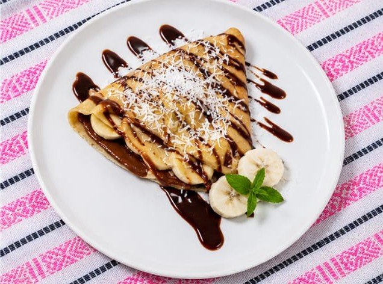

# CABELKI Crêpes — Sitio web

Sitio estático (HTML + CSS + un poco de JS puro, sin frameworks) para la crepería CABELKI.

## 1. Estructura del proyecto

```
cabelki-crepes/
├── index.html
├── styles.css
├── script.js          ← solo el menú hamburguesa del celular
├── README.md
└── assets/
    ├── logo/
    │   └── favicon.svg
    ├── crepes/      ← fotos de crêpes (dulces, saladas y signature)
    ├── drinks/       ← reservada para fotos de bebidas si más adelante quieres reemplazar los íconos
    └── icons/        ← reservada para íconos adicionales
```

## 2. Dónde guardar cada foto de producto

El sitio ya está listo para mostrar fotos reales: cada tarjeta apunta a un archivo dentro de `assets/crepes/`. Mientras no exista el archivo, la tarjeta muestra automáticamente un fondo degradado elegante con un pequeño ícono de crêpe (no verás un ícono de "imagen rota").

Guarda tus fotos con **estos nombres exactos** (idealmente 1200×900 px o proporción 4:3, buena luz, fondo limpio). Puedes usar `.jpg`, `.jpeg` o `.png` — solo asegúrate de que la extensión en el archivo coincida con la que usa `index.html`:

| Archivo en `assets/crepes/` | Producto | Estado |
|---|---|---|
| `hero-crepe.png` | Logo/imagen principal del hero | ✅ Ya subida |
| `red-velvet-berry.jpg` | Red Velvet Berry | ✅ Ya subida |
| `apple-pie-supreme.jpg` | Apple Pie Supreme | ✅ Ya subida |
| `banana-bliss.jpeg` | Banana Bliss | ✅ Ya subida |
| `strawberry-cream.jpg` | Strawberry Cream | ✅ Ya subida |
| `choco-berry-blizz.jpeg` | Choco Berry Blizz | ✅ Ya subida |
| `nutty-golden.jpg` | Nutty Golden | ✅ Ya subida |
| `pepperoni-melt.jpeg` | Pepperoni Melt | ✅ Ya subida |
| `aloha-delight.jpg` | Aloha Delight | ✅ Ya subida |
| `crepe-al-gusto.jpg` | Crêpe al Gusto (sección "arma tu crêpe") | ⏳ Pendiente — hoy muestra un placeholder |
| `fresas-con-crema.png` | Fresas con Crema (vaso, sección `#fresas-con-crema`) | ✅ Ya subida |

En cuanto subas un archivo con el nombre correcto, la imagen reemplaza automáticamente el placeholder — no necesitas tocar el código HTML.

Si más adelante agregas fotos para las bebidas calientes, lo más sencillo es reemplazar los íconos SVG en `index.html` (sección `#bebidas`) por una etiqueta `` apuntando a `assets/drinks/`.

## 3. Ver el sitio en tu computadora

No necesitas instalar nada para verlo:

1. Descarga o clona la carpeta `cabelki-crepes`.
2. Haz doble clic en `index.html` y se abrirá en tu navegador.

Si prefieres un servidor local (recomendado para que las rutas de imágenes se comporten igual que en producción):

```bash
cd cabelki-crepes
python3 -m http.server 8000
```

Luego abre `http://localhost:8000` en tu navegador.

## 4. Publicar en GitHub Pages

1. Crea un repositorio nuevo en GitHub (por ejemplo `cabelki-crepes`).
2. Sube el contenido de esta carpeta a la raíz del repositorio:
   ```bash
   cd cabelki-crepes
   git init
   git add .
   git commit -m "Sitio CABELKI Crêpes"
   git branch -M main
   git remote add origin https://github.com/TU-USUARIO/cabelki-crepes.git
   git push -u origin main
   ```
3. En GitHub, ve a **Settings → Pages**.
4. En "Branch", selecciona `main` y la carpeta `/ (root)`. Guarda.
5. Después de uno o dos minutos, tu sitio estará disponible en:
   `https://TU-USUARIO.github.io/cabelki-crepes/`

### Alternativas igual de sencillas
- **Netlify**: arrastra la carpeta `cabelki-crepes` a [app.netlify.com/drop](https://app.netlify.com/drop).
- **Vercel**: `vercel` desde la carpeta del proyecto (requiere la CLI de Vercel).

## 5. Cómo agregar un nuevo sabor de crêpe

No necesitas tocar `styles.css` — cada crêpe es un bloque de HTML independiente (una "tarjeta") dentro de `index.html`. Para agregar uno nuevo:

1. **Abre `index.html`** y localiza la sección donde quieres agregar el sabor:
   - `id="signature"` → Crêpes Signature
   - `id="dulces"` → Crêpes Dulces
   - `id="saladas"` → Crêpes Saladas

2. **Copia una tarjeta existente completa**, desde `<article class="plate">` hasta su `</article>` de cierre. Por ejemplo, esta es la de "Banana Bliss":

   ```html
   <article class="plate"><div class="ph"></div>
     <div class="pbody"><h3>Banana Bliss</h3><p class="d">Plátano, nutella, coco rallado y chocolate líquido.</p><p class="price num">$123<small>MXN</small></p></div></article>
   ```

3. **Pégala justo debajo**, dentro del mismo `<div class="grid ...">`, y cambia:
   - `src="assets/crepes/banana-bliss.jpeg"` → el nombre de archivo de tu nueva foto (guárdala en `assets/crepes/` con ese mismo nombre y extensión exacta; mientras no exista, se ve un fondo elegante automáticamente).
   - El `alt="..."` → una descripción corta de la foto.
   - `<h3>` → el nombre del sabor.
   - `<p class="d">` → los ingredientes.
   - `<p class="price num">` → el precio.

4. Si quieres que destaque con una etiqueta como "★ Favoritas", agrega dentro de `<div class="ph">`:
   ```html
   <span class="tag">★ Favoritas</span>
   ```

5. Guarda el archivo y ábrelo en el navegador — no hace falta recargar nada más, el nuevo sabor aparece con el mismo estilo (tarjeta con marco y efecto al pasar el cursor) que el resto del menú.

> Tip: la sección "Dulces" usa `grid g4` (hasta 4 columnas según el ancho de pantalla) y Signature/Saladas usan `grid g2` (2 columnas).

## 5b. Crepa de Temporada (sección temporal)

Sección destacada al inicio del menú (`id="temporada"`) con foto, descripción, ingredientes, precio y la etiqueta "Solo de temporada".

- **Foto:** guarda la imagen como `assets/crepes/crepa-de-temporada.png` (mientras no exista se ve un fondo de color).
- **Cambiar de temporada:** edita en `index.html` el nombre (el `<h3>`), la descripción (`class="desc"`), los ingredientes (`class="chips"`) y el precio (`class="price"`).
- **Quitarla cuando termine la temporada:** en `index.html` selecciona todas las líneas entre `SEASON START` y `SEASON END` y presiona **Ctrl+/** (Cmd+/ en Mac). Haz lo mismo con la línea entre `SEASON NAV` y `/SEASON NAV` en el menú. Para volver a mostrarla, presiona Ctrl+/ otra vez.

## 6. Opciones de tipografía

El sitio usa actualmente **Cormorant Garamond** (títulos) + **Lato** (texto) — un estilo más delicado y romántico. Si quieres probar otro estilo, aquí tienes alternativas — todas gratuitas en Google Fonts y afines a la estética boutique del sitio:

| Opción | Títulos | Texto | Sensación |
|---|---|---|---|
| **Actual** | Cormorant Garamond | Lato | Delicado y ligero, letras finas, toque femenino |
| **1 — Editorial clásico** | Playfair Display | Montserrat | El estilo original del sitio — elegante y muy legible |
| **2 — Moderno boutique** | DM Serif Display | Poppins | Serif con más carácter/contraste, combinado con una sans redondeada y amigable |
| **3 — Cálido artesanal** | Fraunces | Nunito Sans | Serif con personalidad "hecho a mano", cálido, menos formal |

Para cambiar de opción:

1. En `index.html`, reemplaza la línea de Google Fonts (dentro de `<head>`) por la combinación elegida, por ejemplo para volver a la opción 1 (Playfair + Montserrat):
   ```html
   <link href="https://fonts.googleapis.com/css2?family=Playfair+Display:ital,wght@0,500;0,600;0,700;1,500;1,600&family=Montserrat:wght@300;400;500;600;700&display=swap" rel="stylesheet">
   ```
2. En `styles.css`, dentro de `:root`, actualiza:
   ```css
   --font-display: "Playfair Display", "Georgia", serif;
   --font-body: "Montserrat", "Helvetica Neue", sans-serif;
   ```
3. Guarda y recarga — el cambio aplica a todo el sitio automáticamente.

> ⚠️ Importante: los nombres de fuente en `--font-display` / `--font-body` solo funcionan si esa misma fuente está cargada en el `<link>` de Google Fonts en `<head>`. Si cambias uno sin el otro, el navegador cae de vuelta a una fuente genérica (Georgia o Helvetica) sin avisar — por eso siempre se cambian los dos juntos.

## 7. Notas de diseño

- **Diseño "champagne & blush noir"**: fondo chocolate con líneas champagne `#D9B98C` y acentos rosa `#E8A6B8`; en dispositivos con modo claro se ve en crema (`#FFF5E8`). Todos los colores viven como variables en `:root` al inicio de `styles.css` (por ejemplo `--bg`, `--gold`, `--rose`) — cambiar un valor ahí actualiza todo el sitio.
- Los precios se muestran en pesos mexicanos con una pequeña etiqueta "MXN" junto al número.
- La sección **"Crêpe al Gusto"** (después de Crêpes Saladas) es una tarjeta destacada de "arma tu crêpe": 1 base a elegir entre 5 + 1 topping a elegir entre 5, por $113. No es interactiva (no hay que hacer clic para seleccionar) — es informativa, igual que el resto del menú.
- La sección **"Fresas con Crema"** (`id="fresas"`, después de "Extra Toppings") reutiliza la misma tarjeta destacada (`feature`) que "Crêpe al Gusto" para mostrar el vaso de 500ml por $115, y debajo repite la lista de toppings (`menu-list`) con sus precios individuales, ya que este producto también admite toppings extra.
- Las secciones **Combos** y **Bebidas** están ocultas (comentadas) en `index.html`; para mostrarlas sigue las instrucciones del comentario `COMBOS` / `BEBIDAS` y descomenta su enlace en el menú.
- El sitio respeta `prefers-reduced-motion`, tiene foco de teclado visible, enlace "Saltar al contenido" y navegación accesible por teclado.
- El botón **"Ordenar ahora"** (sección Contacto, aparece una sola vez) abre WhatsApp directo al número de CABELKI con un mensaje de pedido ya escrito. El botón **"Ver Facebook"** e **"Ver Instagram"** llevan a los perfiles oficiales del negocio.
